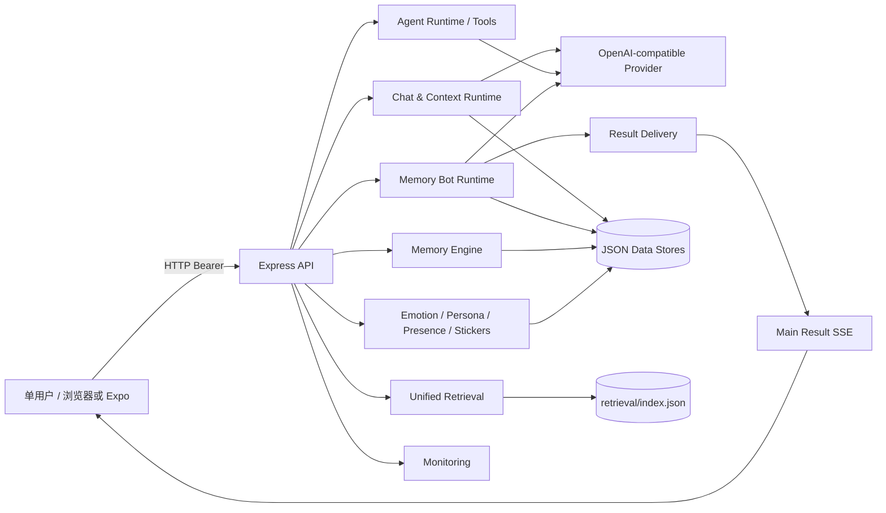

# Bluebird 系统架构现状

> 基线：`main` @ `0a61e9f`（2026-11-08，PR #72 合并提交）  
> 本文件只描述当前实际实现；未实现的边界显式标注。

## 1. 系统上下文

## 2. 模块层级

- **Bluebird** — 单用户本地 Agent 应用（运行中）
  - **客户端 (Expo / React Native / Web)** — 聊天、Bot 工作台、记忆中心、模型/策略/监控 UI（部分实现）
    - **App 壳 / 导航** — 聊天/任务页、设置抽屉、各 Screen（已验证）
    - **聊天 Hooks** — useChatSession、历史、附件、流式、结果注入（已验证；竞态由 lib/api/latest-request.ts 的 createRequestGate 防护）
    - **Bot UI** — MemoryBotScreen、TasksPanel、审批/维护表单（部分实现）
    - **API 客户端** — apiFetch、stream、agent-stream、agent-results-stream（已验证；fetch 仅 apiFetch、路径仅 endpoints.ts 构造）
  - **HTTP API (Express)** — 鉴权、限流、会话/聊天/域服务路由（已验证）
    - **Auth / Rate / CORS** — Bearer、60/min、CORS 精确来源白名单（鉴权与限流先于 body 解析）
    - **Chat 路由** — /chat、/chat/stream、Context Runtime（已验证）
    - **Agent Runtime** — 工具注册、预算、执行、去重（已验证）
    - **Memory Bot** — registry/config/vault/sessions/tasks/approvals/delivery（已实现；维护操作走审批 API，模型不可自行触发）
    - **Memory Engine** — 搜索、候选、生命周期、贡献（已验证 / 设计取舍）
    - **统一检索** — connectors、store、BM25/exact/vector、RRF（backend 已验证；无 UI）
    - **域服务** — emotion/persona/presence/stickers/uploads（已验证）
    - **持久化** — sessions/memory/tasks/events/outbox/index（原子写；保留策略已实现：会话 200 / 消息 1000 / 分页 200）
    - **监控** — trace、metrics、alerts、health（已验证 / 只读）
  - **工程保障** — 测试、CI、覆盖率、文档（通过；计数对齐 scripts/test-coverage-baseline.json 单一基线）
    - **后端测试** — 119 文件 / 2420 项；真实 HTTP + stub（通过）
    - **前端测试** — 22 套 / 190 项；apiFetch mock（通过 / 无 App E2E）
    - **CI** — GitHub Actions；push 仅 main、PR 指向 main，覆盖率脚本单次执行（通过）
    - **文档** — AGENTS/docs/README 计数同源（scripts/sync-doc-counts.js 单一基线，CI --check 兜底）

## 3. 服务端模块职责

| 层 | 模块 | 职责 | 当前状态 |
|---|---|---|---|
| API | `server/index.js` | 路由、鉴权、限流、聊天、域服务、监控挂载 | 已验证（鉴权/限流先于 body 解析、未匹配路由统一 JSON 404） |
| 编排 | `server/context/*` | 历史选择、摘要、记忆/知识检索、上下文构建、输入保护 | 已验证 |
| Agent | `server/agent-runtime.js`, `agent-policy.js`, `tool-*.js` | 工具注册、策略、预算、执行、结果归一化 | 已验证 |
| 子 Agent | `server/agents/*` | Bot registry/config/vault/sessions/tasks/approvals/result delivery | 已实现；记忆 scope 与父会话对齐（P0-01 已闭合） |
| 记忆 | `server/memory*.js` | 搜索、候选、生命周期、贡献、落盘 | 已验证；作用域见 §6 第 4 条，merge 口径见 `docs/p0-blocker-memory-ownership.md` §2.5 |
| 检索 | `server/retrieval/*` | 五类来源、BM25/精确/可选向量、RRF、门控、索引 | backend 已验证；无 UI |
| 域服务 | `server/emotion.js`, `persona.js`, `presence.js`, `uploads.js`, `sticker-repo.js` | 情绪、人格、在线、上传、贴纸 | 已验证 |
| 持久化 | `server/atomic-write.js`, `sessions.js`, `agents/tasks.js` | 原子写、会话、任务、事件 | 有恢复测试；保留策略已实现 |
| 运维 | `server/monitoring/*` | trace、metrics、alerts、health | 已验证只读 |

## 4. 核心数据流

- **记忆注入**：`prepareChatRequest` → `runContextRuntime` → `retrieveMemory` → `memory.searchMemories`（带服务端可信 `userId`，即用户级作用域；无身份时 fail-closed 退回会话级）→ `buildContext` → 模型。
- **外部知识**：`retrieveKnowledge` → `retrieval.searchForContext` → 只注入 document/web/code；memory/conversation 走独立记忆通道。
- **主控工具**：`runAgentTurn` → `executeToolCall` → `memory_search`/`memory_remember`/`knowledge_search`/`delegate_to_bot`。
- **委派**：`delegate_to_bot` → Router（`parentUserId` = 调用方上下文身份，缺省落回实例用户）→ Bot 会话 + task → queue → Bot Runtime → tools（记忆读写归属父主控会话 + `parentUserId`）→ result delivery → 父会话。
- **审批**：approval API → `memory-service` → `memory.js` → atomic write；结果投递闭环（result-delivery.js + SSE snapshot，`bot-result-<taskId>` 幂等）。
- **落盘**：sessions/memory/emotion/presence/agents/tasks/events 各有独立 JSON 文件；没有跨文件事务。

## 5. 运行时拓扑与单点

- 单 Node 进程；单实例锁保护数据目录（获取失败即 exit 1，无返回值被忽略路径）。
- 单文件 JSON 存储；无数据库、无外部队列、无跨进程 Worker。
- 模型调用依赖外部 OpenAI-compatible provider；没有 Provider 时聊天失败，检索可词法降级。
- Memory Bot 任务队列 `TASK_CONCURRENCY` 默认 2（1–4），进程内 `activeRuns`。
- Result Delivery 使用进程内 EventEmitter；SSE 只是通知，消息写入父会话才是持久事实。
- 单点：`sessions.json`、`memory.json`、`agent-tasks.json`、`retrieval/index.json`、provider。

## 6. 信任边界

1. **网络边界**：除 `GET /` 外 Bearer；CORS 为 `BLUEBIRD_CORS_ORIGINS` 精确来源白名单；HTTP/0.0.0.0（当前单用户本地假设）。
2. **用户边界**：单用户 `local-owner`。
   记忆管理接口（`GET /memory`、`/memory/pending`、delete/archive/confirm/reject/clear/clear-session）与 Memory Bot 审批执行器已按可信 `userId` 做归属校验：越权读不返回、越权写返回 403 且数据不变、清空只清本人。见 `docs/p0-blocker-memory-ownership.md`。
   主会话已补 `userId` 维度并强制：`/sessions` 只列本人；他人会话 id 在 `/sessions/:id`、`/history`、`/history/clear|recall`、`/presence`、`/chat`、`/chat/stream`、`/retrieval/search` 一律 404 且数据不变。见 `docs/p0-blocker-session-ownership.md`。
   **多用户上线仍需**：(a) `resolveUserId` 返回真实用户；(b) Bot 会话（`agents/sessions.js`）补 `userId`、默认会话改为每用户一个；(c) 审批记录携带请求者 userId。
3. **Agent 边界**：主控与 Bot 工具 allowlist、policy budget、高风险 deny-only；Bot Key 独立加密。
4. **记忆边界**：长期记忆的**读与写**都按用户级作用域（`visibility: user` + 服务端可信 `userId`，当前单用户即 `local-owner`）跨会话共享——同一用户在任意会话都能召回、更正、合并自己的记忆；原始消息历史、短期上下文、任务执行状态仍按会话/任务隔离；无可信身份时 fail-closed 退回会话级，绝不放开全库。跨会话 merge 是全局设计；Agent 的 `memory_remember` 改写已有记忆时不静默覆盖，候选停在 `pending` 等用户确认（自动抽取路径仍按既有策略直接替代）。见 `docs/p1-user-scoped-memory.md` §5.1。
5. **模型边界**：Provider 返回是外部不可信数据；Context 对知识做 neutralization，`knowledge_search` 输出经中和并附「不可执行」声明；正文中的文本工具调用由 `server/textual-tool-calls.js` 解析、末轮也执行。
6. **存储边界**：JSON at-rest；API Key 明文/前端 token 内嵌；Bot Vault 加密，备份默认排除密钥（`api-keys.json`/`agent-vault.key`/`agent-credentials.json`）。

## 7. 已知缺席/非目标

- 多用户 ACL、分布式任务队列、跨进程 result pub/sub。
- PDF/DOCX 解析、Query Rewrite、完整 AST/语言服务器。
- 真实生产 embedding/reranker、真实模型质量 CI 验收。
- 统一检索前端页面；维护任务执行器；任务取消 UI。

## 8. 架构结论

当前架构是**模块化单体 + 单用户本地持久化**，不是微服务。主控聊天、Context、记忆、检索、Agent 工具与审批均有真实调用链。P0-01（Bot 会话身份被复用为记忆 scope）已由 R-01 闭合：读写同为用户级作用域、委派以 `parentUserId` 接地、Bot 直接对话也走 `resolveUserId`（证据：`REPAIR_ROADMAP.md` §6、`tests/memory-user-scope.test.js`、`tests/agent-dispatch.test.js`）。剩余真实边界见 §7：多用户 ACL、分布式任务队列、跨进程 Worker 仍未实现。
