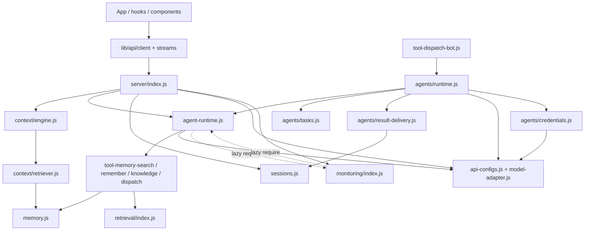
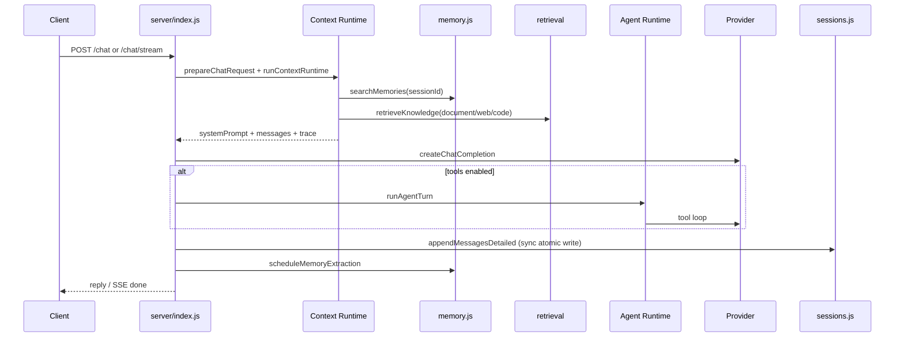
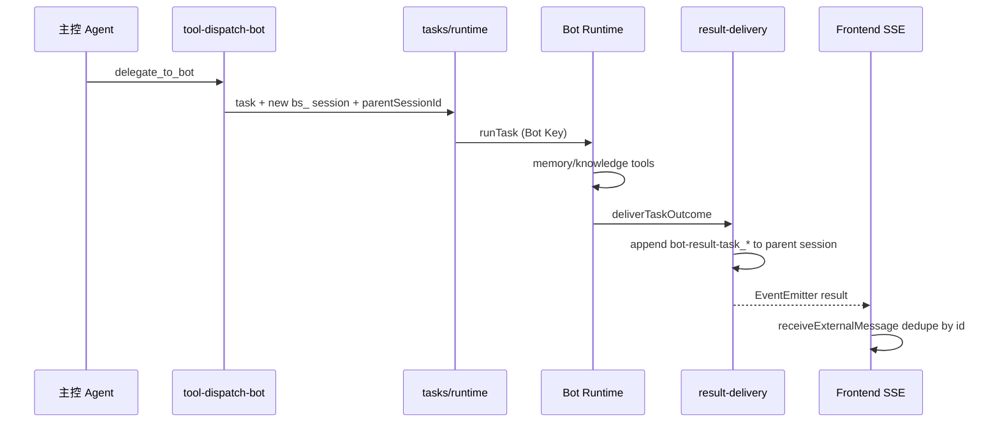
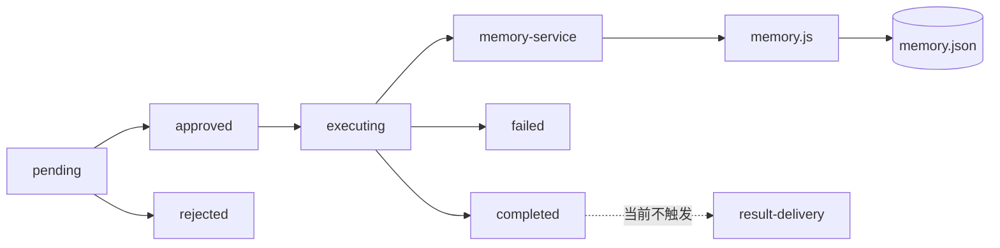

# Bluebird 模块依赖与调用关系

> 基线：`a3569e340945baa9d9aa5e50357b1f8f08e098b7`  
> 静态解析范围：`server/**/*.js` 与 `App.tsx/hooks/lib/components` 的相对 require/import；动态 require 单独标注。

## 1. 依赖规模

- 后端：77 个文件，226 条相对依赖边。
- 前端：62 个文件，195 条相对 import 边。
- 前端未检测到循环依赖；后端静态图有一个 24 文件强连通分量，主要由 lazy require 的 monitoring/agent-runtime 与 tool-dispatch-bot/agents-runtime 桥接造成。

## 2. 核心依赖图

## 3. 静态循环（需在重构时拆分）

- server/agent-runtime.js → server/monitoring/index.js →（lazy require）server/agent-runtime.js
- server/agent-runtime.js → server/tool-dispatch-bot.js → server/agents/runtime.js → server/agent-runtime.js
- server/agent-runtime.js → server/tool-memory-search.js → server/memory.js → server/monitoring/index.js →（lazy）server/agent-runtime.js
- server/agent-runtime.js → server/tool-memory-remember.js → server/memory.js → server/monitoring/index.js →（lazy）server/agent-runtime.js
- server/agent-runtime.js → server/tool-knowledge-search.js → server/retrieval/index.js → server/retrieval/store.js → server/data-events.js → server/monitoring/index.js →（lazy）server/agent-runtime.js
- server/agent-policy.js → server/corruption.js → server/data-events.js → server/monitoring/index.js →（lazy）server/agent-runtime.js → server/agent-policy.js

> 这些循环多数是**运行时安全的延迟 require**：`monitoring/index.js` 在内部函数里按需加载 `agent-runtime`，`tool-dispatch-bot` 在 handler 里加载 `agents/runtime`。本次未观察到启动崩溃；问题是模块边界不清晰，且静态分析无法证明未来不会在加载期访问未完成导出。

## 4. 关键调用链

### 4.1 主控聊天

### 4.2 委派与结果投递

### 4.3 审批

## 5. 同步 / 异步 / 事件边界

| 路径 | 类型 | 证据 |
|---|---|---|
| `/chat` 非流式 | 同步 HTTP；模型等待 | `server/index.js:2990` |
| `/chat/stream` | SSE 流；token delta | `server/index.js:3261` |
| `delegate_to_bot` | 同步创建任务，异步执行 | `server/tool-dispatch-bot.js:147` + `runtime.startTask` |
| 任务队列 | 进程内异步调度 | `server/agents/runtime.js:32-63` |
| Result Delivery | 同步写父会话 + EventEmitter 通知 | `server/agents/result-delivery.js:104-202` |
| Memory/Emotion 写入 | `enqueueWrite` 异步串行 + 原子写 | `server/memory.js` |
| Retrieval ingest | 异步队列 + 单文件原子写 | `server/retrieval/index.js` |
| Monitoring | 追加/轮转 JSONL | `server/monitoring/store.js` |

## 6. 单点与断裂链路

- **单点**：sessions.json 单文件 + 进程内 sync 写
- **单点**：agent-tasks.json/agent-events.json 单文件与单进程队列
- **单点**：result-delivery 使用进程内 EventEmitter，无跨进程投递
- **单点**：memory.json 单文件 + enqueueWrite 单进程串行
- **单点**：retrieval/index.json 单文件 + 最多 64MB 向量
- **单点**：模型服务商是唯一外部依赖；Provider 不可用时仅词法/精确降级

- **断裂/缺口**：统一 retrieval 有 backend API，没有前端 UI
- **断裂/缺口**：memory.maintain/memory.audit 是 accepted task type，但没有维护/审计工具
- **断裂/缺口**：任务取消 API 没有任务页按钮
- **断裂/缺口**：审批完成不走实时 result delivery
- **断裂/缺口**：session delete 不清理 uploads/retrieval conversation index
- **断裂/缺口**：删除记忆/撤回不立即清理 retrieval derived index

## 7. 前端 API 调用面

- `lib/api/endpoints.ts` 覆盖 sessions/history/memory/models/agents/tasks/approvals/presence/monitoring。
- 直接路径构造：`lib/stream.ts`、`lib/agent-stream.ts`、`lib/agent-results-stream.ts`、`lib/uploads.ts`（与 endpoints.ts 注释的“唯一出口”不一致）。
- 无消费者：`agentPermissions`、`agentTaskCancel`、`modelProviderEnabled`、`memoryPending`、`monitoringMeta`、`monitoringMetrics`。
- 无前端 UI：`/retrieval/*`、`DELETE /uploads/image/:id`、sticker PATCH/DELETE/collect/semantic 等。
- 结果 SSE 与 Agent chat stream 是直接 XHR，不在 endpoints 常量中。

## 8. 结论

主控/Context/记忆/检索/Agent 的主干依赖清晰且真实；Memory Bot 的 `tool-dispatch-bot → agents/runtime → agent-runtime` 通过 lazy require 形成可运行但边界模糊的环。最大的架构问题不是“图复杂”，而是 **Bot 会话身份被复用为记忆 scope**（P0-01），以及若干“API 存在但无消费者/执行器”的断裂链路。
