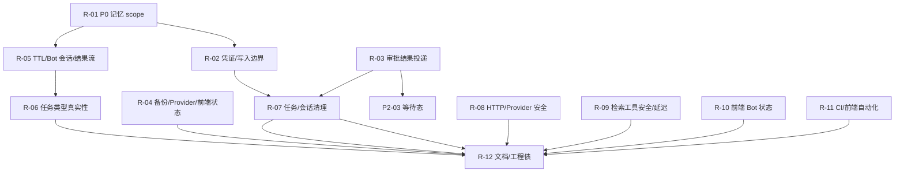

# Bluebird 工程修复路线图

> 本文件以依赖关系排序，不是按问题编号排序。  
> 原始计划（审计轮次产出）保留在下方；执行状态见 §6，随每个修复波次更新。  
> 验收原则：每个修复项必须有真实调用链证据，不以“测试全绿”替代；  
> 任何删除/清理必须先验证“不是活跃/未投递数据”。

## 0. 路线图依赖



## 1. 修复波次

### R-01 拆分 Bot 对话会话与记忆 scope，修复委派记忆读写

- **状态**：已实现并验证（提交与证据见 §6）
- **波次**：0（0 为最先）
- **优先级/类型**：P0 · 必须修复
- **关联问题**：P0-01
- **依赖**：无
- **影响模块**：Memory Bot、Memory Engine、Agent dispatch
- **验收标准**：主控会话写入的记忆可被同会话委派 Bot 检索；Bot 写入归属父会话；无记忆 seed 到 Bot session 的测试通过。

### R-02 收紧 Agent 凭证与写入信任边界

- **状态**：已实现并验证（提交与证据见 §6）
- **波次**：1（0 为最先）
- **优先级/类型**：P1 · 必须修复
- **关联问题**：P1-01、P1-02、P1-03
- **依赖**：R-01
- **影响模块**：Model providers、Memory Bot、Memory Engine、Approvals
- **验收标准**：凭证 provider 不匹配拒绝；原始用户引用/授权可追溯；自动 UPDATE/MERGE 有明确确认或审批。

### R-03 闭合审批结果投递与等待态

- **状态**：已实现并验证（提交与证据见 §6）
- **波次**：1（0 为最先）
- **优先级/类型**：P1 · 必须修复
- **关联问题**：P1-04、P2-03
- **依赖**：无
- **影响模块**：Approvals、Result Delivery、Tasks、UI
- **验收标准**：审批完成后父会话实时收到结果；waiting_approval 不被 runTask 覆盖；有端到端测试。

### R-04 修复备份密钥、模型能力编辑与前端会话/持久化显示

- **状态**：已实现并验证（提交与证据见 §6）
- **波次**：1（0 为最先）
- **优先级/类型**：P1 · 必须修复
- **关联问题**：P1-05、P1-06、P1-07、P1-08
- **依赖**：无
- **影响模块**：Persistence、Model providers、Frontend chat
- **验收标准**：备份不含密钥；编辑 provider 保留能力；切会话加载期间不可发送；persisted:false 有 UI 错误。

### R-05 修复记忆 TTL 双路径、Bot 会话上限/结果流生命周期

- **状态**：已实现并验证（提交与证据见 §6）
- **波次**：1（0 为最先）
- **优先级/类型**：P1 · 必须修复
- **关联问题**：P1-09、P1-10、P1-11
- **依赖**：R-01
- **影响模块**：Context Engine、Memory Engine、Memory Bot、Result Delivery
- **验收标准**：同一记忆在注入/工具路径规则一致；200 会话前有清理/复用；结果流对非 200/关闭可重连。

### R-06 移除或实现 memory.maintain/audit 任务类型

- **状态**：已实现并验证（提交与证据见 §6）
- **波次**：1（0 为最先）
- **优先级/类型**：P1 · 必须修复
- **关联问题**：P1-12
- **依赖**：无
- **影响模块**：Manifest、UI、Task API
- **验收标准**：任务类型与真实执行器一一对应；UI 不展示无法执行的类型。

### R-07 任务/会话保留策略与数据清理

- **状态**：已实现并验证（提交与证据见 §6）
- **波次**：2（0 为最先）
- **优先级/类型**：P2 · 建议修复
- **关联问题**：P2-02、P2-08、P2-10
- **依赖**：无
- **影响模块**：Tasks、Sessions、Retrieval、Uploads
- **验收标准**：只裁剪已投递终态；删除会话/记忆同步清理派生索引与附件；容量测试。

### R-08 HTTP 与 Provider 调用期安全硬化

- **状态**：已实现并验证（提交与证据见 §6）
- **波次**：2（0 为最先）
- **优先级/类型**：P2 · 建议修复
- **关联问题**：P2-11、P2-12、P2-13、P2-14
- **依赖**：无
- **影响模块**：HTTP API、Model Adapter、Startup、Chat
- **验收标准**：CORS/鉴权前 body/错误处理/限流失败锁定；调用期 DNS 固定；锁失败退出；非流式断连 abort。

### R-09 检索与工具安全/延迟

- **状态**：已实现并验证（提交与证据见 §6）
- **波次**：2（0 为最先）
- **优先级/类型**：P2 · 建议修复
- **关联问题**：P2-07、P2-09
- **依赖**：无
- **影响模块**：Retrieval、knowledge_search、Context
- **验收标准**：tool 结果 neutralize + 不可执行声明；向量/reranker 纳入 deadline，超时降级。

### R-10 前端维护/Bot 流式状态与任务表单

- **状态**：已实现并验证（提交与证据见 §6）
- **波次**：2（0 为最先）
- **优先级/类型**：P2 · 建议修复
- **关联问题**：P2-15、P2-16、P2-19
- **依赖**：无
- **影响模块**：MemoryBotScreen、TasksPanel、Approvals
- **验收标准**：withdraw scope 正确；update 不隐式改 type；切会话 abort/丢弃旧流；任务表单明确 parent 归属。

### R-11 CI 去重与前端自动化

- **状态**：已实现并验证（提交与证据见 §6）
- **波次**：2（0 为最先）
- **优先级/类型**：P2 · 建议修复
- **关联问题**：P2-17、P2-18
- **依赖**：无
- **影响模块**：CI、Frontend tests
- **验收标准**：push/PR 不双跑；覆盖率门禁不重复执行全部测试；补 App/hook/结果流测试。

### R-12 文档、版本、路径与死代码清理

- **状态**：已实现并验证（提交与证据见 §6）
- **波次**：3（0 为最先）
- **优先级/类型**：P3 · 暂缓优化
- **关联问题**：P3-01、P3-02、P3-03、P3-04、P3-05、P3-06、P3-07、P3-08、P3-09、P3-10、P3-11、P3-12
- **依赖**：R-01、R-02、R-03、R-04、R-05、R-06、R-07、R-08、R-09、R-10、R-11
- **影响模块**：Docs、Frontend paths、Sessions、CI
- **验收标准**：文档计数由单一来源生成；无过期声明；路径收口；死导出/端点清理；版本一致。


## 2. 必须 / 建议 / 暂缓

| 类型 | 项 | 说明 |
|---|---|---|
| 必须修复 | R-01～R-06 | P0 与核心 P1；影响记忆正确性、凭证安全、审批/结果回传、运行状态真实性 |
| 建议修复 | R-07～R-11 | 数据保留、安全边界、检索延迟、前端状态、CI/测试；可在核心修复后并行 |
| 暂缓优化 | R-12 | 文档、版本、死代码、路径收口、性能；不改变核心行为 |

## 3. P0/P1 修复依赖与影响

| 问题 | 修复项 | 前置 | 影响 |
|---|---|---|---|
| P0-01 | R-01 | 无 | Memory Bot 读写 scope、委派结果、后续所有委派测试 |
| P1-01/P1-02/P1-03 | R-02 | R-01 | Bot 凭证、写入接地、自动维护语义 |
| P1-04/P2-03 | R-03 | 无 | 审批结果实时投递、任务状态机 |
| P1-05/P1-06/P1-07/P1-08 | R-04 | 无 | 备份、Provider 编辑、前端会话/落盘提示 |
| P1-09/P1-10/P1-11 | R-05 | R-01 | TTL、Bot 会话上限、结果流重连 |
| P1-12 | R-06 | 无 | 任务类型真实性/UI |
| P2-02/P2-08/P2-10 | R-07 | 无 | 任务、索引、附件清理 |
| P2-11/P2-12/P2-13/P2-14 | R-08 | 无 | HTTP/Provider/启动/断连安全 |
| P2-07/P2-09 | R-09 | 无 | 工具注入面、Context 延迟 |
| P2-15/P2-16/P2-19 | R-10 | 无 | 维护表单、Bot 流式、任务归属 |
| P2-17/P2-18 | R-11 | 无 | CI 去重、前端自动化 |
| P3-01～P3-12 | R-12 | 所有核心项 | 文档/工程债 |

## 4. 验收原则

1. 每个修复项必须有真实调用链证据，不以 npm test 全绿替代。
2. P0/P1 修复必须新增“旧缺陷会失败”的回归测试；测试不得把 Bot session 作为记忆贡献 seed 来绕过 scope。
3. 任何删除/清理（任务、会话、索引、附件）必须先验证“不是活跃/未投递数据”，并写入审计事件。
4. 任何安全修复不得以关闭现有能力为代价；如无法修复，必须在 UI 明确显示 unavailable，不得伪装成功。
5. 修复完成后再更新文档与可视化健康度；不要用报告中的旧评分继续声称已修复。

## 5. 本轮不做的内容

- 不重写 Agent Runtime / Memory Service / Context Engine。
- 不引入分布式 Worker、多用户 ACL、外部向量数据库。
- 不为通过测试降低测试标准。
- 不覆盖用户现有 `server/data`。

## 6. 执行状态（截至 2026-10-31）

执行分支：`qoder/audit-p0-memory-scope-2026-10-31`（已推送；PR #48 处于 OPEN 状态，**未合并**）。

### 6.1 R-01～R-11：已实现并验证

| 修复项 | 状态 | 提交 | 验证证据 |
|---|---|---|---|
| R-01 | 已实现并验证 | `79c98a4` | `tests/agent-dispatch.test.js`（10 项）：主控→Bot 委派的父会话读/写 scope、委派结果归属 |
| R-02 | 已实现并验证 | `00465ec` | `tests/memory-bot.test.js`（9 项，Bot 凭证绑定到当前 provider）、`tests/memory-agent-write.test.js`（13 项）、`tests/memory-lifecycle-decisions.test.js`（17 项）；真实链路：Bot 用独立加密 Key 完成委派任务，凭证校验通过 |
| R-03 | 已实现并验证 | `b654bec` | `tests/agent-dispatch.test.js`：审批 waiting / 完成 / 拒绝三态投递，`waiting_approval` 不被 runTask 覆盖 |
| R-04 | 已实现并验证 | `5abeb24` | `tests/backup.test.js`（50 项，备份不含密钥）、`tests/model-providers.test.js`（115 项，编辑 provider 保留能力声明）、`tests/unit/use-chat-session.test.tsx`（切会话期间不可发送、`persisted:false` 有错误提示） |
| R-05 | 已实现并验证 | `1c8fe17`、`33d5853` | `tests/memory-bot.test.js`（TTL 双路径一致、200 Bot 会话复用最早空会话）、`tests/context-engine.test.js`（48 项）、`tests/unit/agent-results-stream.test.ts`（401 永久失败 / 5xx 与 200 干净关闭可重试 / abort 为 closed）、`tests/unit/use-bot-result-stream.test.tsx`（指数退避重连） |
| R-06 | 已实现并验证 | `1c8fe17` | `server/agents/manifest.js` 已移除 `memory.maintain` / `memory.audit`；工作台不再展示没有执行器的任务类型 |
| R-07 | 已实现并验证 | `5b86614` | `tests/delete-semantics.test.js`（43 项：删除会话/记忆同步清理派生索引与孤儿附件）、`tests/memory-api-recall.test.js`（41 项）、`tests/memory-bot.test.js`（500 任务只裁剪已投递终态、200 会话容量用例） |
| R-08 | 已实现并验证 | `9cff3c6`、`87a8cb9` | `tests/api.test.js`（32 项：CORS 白名单、鉴权前 body、限流与失败锁定、JSON 错误）、`tests/model-providers.test.js`（115 项：调用期 DNS 固定）、`tests/chat-abort.test.js`（9 项：客户端断开中止非流式上游调用）、`tests/memory-startup-lock.test.js`（34 项：数据目录不可用时拒绝启动） |
| R-09 | 已实现并验证 | `9cff3c6` | `tests/retrieval-api.test.js`（13 项：knowledge_search 中和 + 不可执行声明）、`tests/retrieval-embeddings.test.js`（10 项：向量/重排纳入 deadline 并显式降级） |
| R-10 | 已实现并验证 | `ea17692` | `tests/unit/memory-bot-screen.test.tsx`（5 项：withdraw scope、update 不隐式改 type、切会话 abort 并丢弃旧流、停止按钮、任务归属说明） |
| R-11 | 已实现并验证 | `ea17692` | `scripts/verify-test-coverage.test.js`（18 项，覆盖率脚本自检）、`tests/unit/app-smoke.test.tsx`、`tests/unit/use-bot-result-stream.test.tsx`；CI 只在 main push / 指向 main 的 PR / 手动触发触发，并由覆盖率脚本单次执行全部后端文件与 Jest |

真实链路证据（发布验收，2026-10-31）：主控 `delegate_to_bot` → 真实 `Qwen2.5-0.5B-Instruct`（本地 ONNX int8）Bot 任务完成 → `deliveryStatus=delivered` → 主控 SSE 实时收到 `bot-result-<taskId>` → `/history` 出现【Memory Bot 任务完成】。主控那一段使用确定性 HTTP provider（0.5B 模型产不出 tool_calls），因此按段标注真实性，不声称整链都是真实模型。

### 6.2 原路线图未覆盖的 P2 条目：已修复

以下 P2 条目在原路线图里没有任何 R-xx 覆盖，审计时仍然开放。本轮已修复，证据为代码与回归测试：

| 问题 | 修复内容 | 证据 |
|---|---|---|
| P2-01 | 跨会话 MERGE 的去重路径补上可见范围约束。`server/memory-decision.js` 在 `duplicates` 路径判定 `visible === false` 时改判 `same_fact_other_session`；`server/memory.js` 的 `applyCandidate` 收到该 reason 时只追加 contribution，**不**用本次候选改写对方条目的正文 / 类型 / 关键词 / 置信度 | `tests/memory-lifecycle-decisions.test.js`（跨会话 MERGE 只追加贡献、保留原文） |
| P2-04 | 任务的 `deadlineMs` 现在在运行时执行：`server/agents/runtime.js` 在任务进入 `running` 时起算截止时间，到期 abort 本次运行并把任务收敛成 `timed_out` / `deadline_exceeded`（不可重试），而不是被误判成用户取消 | `tests/agent-runtime-guards.test.js`（task deadlineMs） |
| P2-05 | `reachedMaxRounds` 改为与本次 policy 的 `maxRounds` 比较（循环用的就是它），不再与全局 `MAX_ROUNDS` 比较；`maxRounds` 一并回传 | `tests/agent-runtime-guards.test.js`（policy maxRounds） |
| P2-06 | 工具调用结束后摘掉挂在外部 AbortSignal 上的监听器（`once:true` 只在信号真的触发时移除，十几次工具调用会在同一信号上累积监听器） | `tests/agent-runtime-guards.test.js`（abort-listener cleanup） |

### 6.3 R-12（P3）：已实现并验证

P3-01～P3-12 全部在本分支处理。逐条证据：

| 问题 | 处理方式 | 证据 |
|---|---|---|
| P3-01 文档漂移 | 测试计数改为**单一来源**生成：`scripts/test-coverage-baseline.json` 是唯一手写处，`scripts/sync-doc-counts.js` 从它重建 AGENTS.md / README.md / docs/* 与 CI 注释里的每个计数，`--check` 模式在 CI 里比对。每条声明用正则锚点定位，命中 0 次或多次都直接报错，不静默跳过。TasksPanel 改写为真实语义（只读审计视图，没有创建 / 取消控件） | `scripts/sync-doc-counts.test.js`（10 项）、`node scripts/sync-doc-counts.js --check` → backend 1622 / nodeSuite 221 / runner 1401 / frontend 179 / 文件 51 |
| P3-02 `GET /` 版本号 | 版本号改从 `package.json` 读取，删掉硬编码的 `0.3.0` | `server/index.js`（`SERVER_VERSION`）、`tests/api.test.js` |
| P3-03 前端 API 路径收口 | 所有路径字面量只剩 `lib/api/endpoints.ts` 一处；`lib/uploads.ts` 与三个 XHR 流（`lib/stream.ts` / `lib/agent-stream.ts` / `lib/agent-results-stream.ts`）统一用 `API_BASE = process.env.EXPO_PUBLIC_API_URL ?? ''`，不再拼未回退的裸环境变量 | `tests/unit/api-base-url.test.ts`（6 项）。负向对照：把两个文件改回裸环境变量拼接后该套件失败 2 项（`undefined/chat/stream`），恢复后通过 |
| P3-04 只有接口没有 UI | 建 `scripts/api-capability-registry.json`：93 条后端路由归入 19 个路由族，逐条标注 `ui` / `api-only` 与前端消费者；`scripts/verify-api-capabilities.js` 在 CI 里校验——路由未登记、登记族不存在、标 `ui` 却无消费者、标 `api-only` 却有消费者，四种都失败。9 个仅 API 的能力写进 AGENTS.md 并注明**按设计如此、不是缺陷**（不删接口、不谎称界面可用） | `node scripts/verify-api-capabilities.js` → 后端路由 93 条、路由族 19 个、仅 API 的能力 9 个 |
| P3-05 `parentMessageId` | **审计结论已过期**：派发工具把本轮用户消息 id 原样带进任务（`server/tool-dispatch-bot.js` → `tasks.createTask`），并非恒为 null。补断言证明这条链路 | `tests/agent-dispatch.test.js`（断言 `finished.parentMessageId === 'main-user-1'`） |
| P3-06 `buildMemoryContext` 死代码 | 不是死代码：它与 `searchMemories` 共用 `scopeOf` / `visiblePool` / `rankMemories`，是固定评测集（`tests/memory-eval/`）与作用域回归断言的渲染基线。**不删**（删掉会拆掉评测能力），改为把「线上注入走 Context Runtime v3」写清楚，纠正 `tests/memory-eval/run-eval.js` 里「/chat 线上真正走的那条」的过期说法 | `server/memory.js` 注释、`tests/memory-eval/run-eval.js` |
| P3-07 过期导出与说明 | 删除无调用点的 `supportsTool` 导出；`server/retrieval/index.js` 里「网页抓取存在 DNS 解析与连接之间的 TOCTOU 风险（已知限制）」的过期说明改为描述真实行为（解析后校验全部地址并固定给本次连接，每跳重定向重新解析、重新校验、重新固定） | `server/agent-runtime.js`、`server/retrieval/index.js` |
| P3-08 `sessions.saveStore` 持久化 | 改用共享的 `writeFileAtomicSync`（临时文件 `'wx'` 独占创建 → fsync → rename → 父目录 fsync），不再自己拼 `${STORE_FILE}.tmp.${pid}` 用 `'w'` 打开——原先的注释声称与 atomic-write 对等，实际并不对等 | `server/sessions.js`、`tests/sessions.test.js`（临时文件独占 + 落盘失败回滚） |
| P3-09 主会话无上限 | 加 `SESSION_MAX = 200`：到上限时先回收**最老且没有消息**的空会话（不含默认会话），没有可回收的就返回 `409 session_limit`，绝不删有对话的会话。回收与拒绝都写审计事件 | `server/sessions.js`、`tests/sessions.test.js`、`tests/api.test.js` |
| P3-10 状态码与错误格式 | 存储只读等「服务当前不可用但没坏」的场景统一 `503 store_unavailable`（原先是 500），会话数超限是 `409 session_limit`；未匹配路由统一 JSON `404 { error, code: 'not_found' }`；body-parser / 未捕获错误统一 `{ error, code }`（`invalid_json` / `payload_too_large` / `bad_request` / `internal_error`），前端 `ApiError` 契约依赖这个形状 | `server/index.js`、`tests/api.test.js` |
| P3-11 覆盖率口径与 Node 声明 | AGENTS.md 写清门禁**是**运行时用例数逐文件对账、**不是**行覆盖率阈值（百分比门槛不存在，套件内部未被覆盖的分支它抓不到），并删掉过期的「204 static vs 214 runtime」句子；Node 版本声明补齐：`package.json` `engines.node >= 22`、根目录 `.nvmrc` = 22、CI `actions/setup-node@v5` + `node-version: '22'` + `actions/checkout@v5` | `package.json`、`.nvmrc`、`.github/workflows/ci.yml`、AGENTS.md |
| P3-12 确认守卫与 outbox 上限 | 清理类接口的二次确认不再因为「数据目录在系统临时目录」而被绕过——确认与否只取决于请求方是否显式带 `confirm: true`；事件 outbox 加 `OUTBOX_MAX = 500` 硬上限，超限丢最旧并按次记录 `agent_event_outbox_overflow`（`dropped` / `action` / `reason` / `cap`），不假装全都保存了 | `server/index.js`（`clearGuardError`）、`server/agents/tasks.js`（`OUTBOX_MAX`）、`tests/agent-storage-limits.test.js`（2 项） |

### 6.4 本轮门禁（2026-10-31，本地实跑）

- `npm test`：51 个后端测试文件，全部通过。
- `node scripts/verify-test-coverage.js`：`backend=1622/1622 nodeSuite=221/221 runner=1401/1401`、`frontend=179/179 suites=22/22 failed=0`、CI runner 覆盖 `51/51`。
- `node scripts/sync-doc-counts.js --check`：✔ 文档计数与基线一致（backend 1622 / nodeSuite 221 / runner 1401 / frontend 179 / 文件 51）。
- `node scripts/verify-api-capabilities.js`：✔ API 能力登记一致（后端路由 93 条、路由族 19 个、仅 API 的能力 9 个）。
- `node scripts/sync-doc-counts.test.js`：10 项通过；`node scripts/verify-test-coverage.test.js`：18 项通过。
- `npx tsc --noEmit`：通过（0 错误）。
- `npm run lint`：通过（0 错误）。
- 运行时隔离守卫：跑完全量后仓库内仍不存在 `server/data`。
- 负向对照（确认新测试确实能捕获旧缺陷）：前端两个文件改回裸环境变量拼接 → `api-base-url` 失败 2 项（`undefined/chat/stream`），恢复后通过。

CI 新增三步（`.github/workflows/ci.yml`）：`node scripts/sync-doc-counts.test.js`、`node scripts/sync-doc-counts.js --check`、`node scripts/verify-api-capabilities.js`。

### 6.5 运行时隔离守卫复核（2026-10-31）

CI 的「隔离守卫（运行时）：测试不得在仓库内留下 server/data」此前只有代码层面的论证，本轮做了实跑验证。

- 工作树里原先存在的 `server/data/`（仅 `memory.json`，3 字节 `[]\n`，与 `server/memory.js` 首启排他创建的空库字节一致）判定为本地手工启动服务的残留、不是测试产物，已整目录移出仓库备份到系统临时目录（`%TEMP%\bluebird-server-data-backup-20261031-232708`，内容原样保留，未删数据）。
- 移出后按 CI 顺序实跑：`npm test` → 51 个文件全部通过，守卫通过（`server/data` 未被重建）；`node scripts/verify-test-coverage.js` → `backend=1622/1622 nodeSuite=221/221 runner=1401/1401`、`frontend=179/179 suites=22/22 failed=0`、CI 覆盖 `51/51`，守卫仍通过（`server/data` 仍不存在）。当前 `git status` 只剩 5 份未跟踪的审计交付物。
- 残留存在时再跑一次全量作为对照：`server/data` 的路径 / 大小 / mtime / sha256 指纹跑前跑后完全一致 → 测试套件不触碰真实数据目录。
- 三层隔离证据：`scripts/run-tests.js:31-34` 与 `scripts/verify-test-coverage.js:215-218` 给每个子进程注入临时 `BLUEBIRD_DATA_DIR`；9 个会启动服务的测试文件自身在 require 服务模块之前先设临时目录（`tests/api.test.js:19-20`、`tests/sessions.test.js:49`、`tests/sessions-recovery.test.js:93-97` 等，数据目录在模块首次加载时求值，晚设就无效）；`tests/api.test.js:98` + `:112-129` 与 `tests/memory-api-recall.test.js:83-95` 对「生效数据目录是否落在真实目录内」做前置守卫，破坏性断言在目录未隔离时直接失败。

### 6.6 无法在本仓库修复的条目（明确列出）

以下条目不是「暂时没做」，而是**在本仓库的边界内修不了**。按 §4 原则 4，任何安全修复不得以关闭现有能力为代价，因此这些项一律保留能力、如实记录状态，不伪装成已修复。

| 问题 | 分类 | 为什么修不了 | 现状与用户可见后果 | 解除条件 |
|---|---|---|---|---|
| P2-20 全局模型 Key 明文存储 | 已知限制 | `server/api-keys.json` 存明文，防护只靠文件权限（0600 best-effort）与 `server/data` 的 gitignore。真正的静态加密需要一个外部主密钥（KMS / 口令派生），而仓库里**禁止**硬编码主密钥；把主密钥放进仓库等于把密钥换个地方存。备份侧已提供 `--encrypt-secrets` + `BLUEBIRD_BACKUP_KEY` 路径，但那是备份快照的加密，不是数据目录的加密 | 密钥从不返回给任何路由、从不进日志（`tests/model-providers.test.js` 有泄漏扫描）；单用户本地部署可接受。**不能**用于多用户或公网暴露 | 部署方提供外部密钥管理（KMS / 密钥文件挂载 + 权限），或接受该风险并限定部署形态 |
| P2-20 前端 Bundle 内嵌 API Token | 已知限制 | Expo / React Native 的 `EXPO_PUBLIC_*` 变量会被打进前端产物，这是 Expo 的运行机制，不是本仓库能改的；改成不内嵌需要原生安全存储（Keychain / Keystore）或由后端下发短期令牌，两条路都要改部署与鉴权模型，超出本轮范围 | Token 只授予单机本地后端的全部接口访问权；配合 P2-20 的 HTTP + `0.0.0.0` 监听，构成「同网段可访问」的暴露面。这是**部署形态限制**，不是代码缺陷 | 引入原生安全存储 + 后端签发短期令牌；或部署时把后端绑到回环地址并加反向代理鉴权 |
| P2-20 HTTP / `0.0.0.0` 监听 | 已知限制 | `app.listen(PORT, '0.0.0.0')` 是为了让手机（真机）能连上开发机；改成 `127.0.0.1` 会让真机调试失效。TLS 终止需要证书与反向代理，属于部署拓扑而非应用代码 | 服务无传输加密、无客户端证书；CORS 只挡浏览器跨源，挡不住同网段直连 | 部署时用反向代理（TLS + 鉴权）终止，或改绑回环地址并用隧道（adb reverse / tailscale）给真机访问 |
| P2-21 有主会话贡献时无归属 legacy 记忆不可见 | 设计假设 | 这是 P0-01 修复的**目的**本身：`scopeOf` 的 primary / legacy / excluded 三段划分，保证一条会话永远看不到另一条会话的私有事实。把无归属 legacy 记忆重新放回当前会话上下文，等于重新打开 P0-01 关掉的隐私泄漏口子。因此「修掉」它就等于退回一个已确认的缺陷 | 库里有、但本会话查不到，用户可能以为记忆丢了。**不是真的丢了**：Memory Center 读的是 `GET /memory?scope=all`（`API_PATHS.memoryAll`），无归属条目在界面里照常可见、可编辑、可删除；不可见的只是「自动注入本会话模型上下文」这一条路径 | 若要改变，须先定义「无归属记忆归谁」的产品规则（例如显式归属到某个会话，或引入用户可见的归属选择），再改 `scopeOf`；不能由实现层自行决定 |

除此之外，§6.2 与 §6.3 的条目全部已修复。P3-04 有一处需要说明口径：**界面没有新增入口**，9 个仅 API 的能力按设计保留为「有接口、无界面」，并由登记册与 CI 门禁保证「文档说的和代码做的」一致；按 §4 原则 4 不得为了让缺口消失而删接口或谎称界面可用。

### 6.7 PR #48 CI 失败：定位与修复（2026-11-01）

**失败现象**（PR #48，CI「全量测试 + 覆盖率对账（单次执行）」，run `41220043071`，head `b4af9c2`）：

- TAP：`not ok 7 - 主控结果 SSE：snapshot 重连可见，实时结果无需轮询`，`duration_ms: 6039.575063`，`failureType: testCodeFailure`，栈顶 `new DOMException` ← `AbortController.abort` ← `Timeout._onTimeout (tests/agent-dispatch.test.js:671:45)`。
- 覆盖率对账随之失败：`backend=1612/1622 nodeSuite=221/221 runner=1391/1401`——`tests/agent-dispatch.test.js` 整个文件判定失败，它贡献的 10 个运行时用例被剔除，总数因此对不上基线。

**根因：产品链路没问题，是测试自己写错了时序假设。**

服务端 `GET /agent-results/stream`（`server/agents/routes.js:66-115`）在**建连时**先写一帧 snapshot，并在**同一个同步块**里调用 `resultDelivery.subscribe()`。于是有两种合法时序：

| 时序 | 客户端收到什么 | 旧断言（等顶层 `result` 事件） |
|---|---|---|
| 结果投递 **早于** 订阅建立 | 只有一帧 `snapshot`，结果嵌在 `results` 里 | 顶层 `result` **永远不来** → 必然等到 6s 超时 |
| 结果投递 **晚于** 订阅建立 | 顶层 `result` 事件实时到达 | 正常通过 |

旧测试用 `readSseUntil(url, predicate)` 起流后**并发**派发任务，再等 `event.type === 'result'`，等于把「投递必须晚于订阅」当成了前提；投递抢赢时断言必然失败。审批闭环用例里那处靠 `setTimeout(100ms)` 猜时序的写法同样不可靠。

**复现证据**（真实服务端 + 真实 SSE 客户端，不 mock）：

```
[A] 收到帧类型： snapshot
[A] 顶层 result 事件数： 0
[A] snapshot 内含该任务结果： true
[A] 结论： 订阅晚于投递 → 只有 snapshot，顶层 result 永远不会来 → 测试判定必然超时
[B] 握手帧类型： snapshot
[B] 随后收到的顶层事件： result(taskId=task_138a407b-1de1-49c4-905c-a141b0d73e43)
[B] 结论： 先订阅后投递 → 顶层 result 实时到达，实时推送链路本身是好的
```

**修复**（只改测试与文档，未改产品行为、未删任何能力）：

- `tests/agent-dispatch.test.js`：把 `readSseUntil` 拆成 `openSse()`（建连）+ `readSseFrame()`（读帧并按谓词过滤）；SSE 用例改为**先握手再断言**——收到 `snapshot` 帧即代表订阅已建立，随后才派发任务并等待顶层 `result` 事件；审批闭环用例里那处 `setTimeout(100)` 的猜测时序换成同一套握手。
- 断言失败时补上诊断信息（交付文案全文 + 任务终态与 `errorCode`），失败日志能直接看出是「未完成」还是「文案不符」。
- `docs/memory-bot.md`：补「结果流时序契约」一条，把「客户端收到 snapshot 帧 = 订阅已建立」「先投递后建连只会拿到 snapshot」「前端 snapshot 分支会逐条回放 results 给 `onResult`」写清楚，避免后续再按错误前提写测试。

**验证**：

- `tests/agent-dispatch.test.js` 10 项全通过；SSE 用例耗时 ~194ms（修复前必然跑满 6s 超时）。
- 本地连跑 **200 轮** `node tests/agent-dispatch.test.js`：0 失败。修复前的那个 6s 超时是 CI 上观测到的（run `41220043071`），本机未稳定复现——因为它取决于「投递与订阅谁先到」的运气，快机器上通常是订阅先建立（结果走实时推送），CI 那次恰好投递先到。
- 对照组：`origin/main`（`6af05fe`）在独立 worktree 里连跑 **150 轮**同一测试文件：0 失败——main 上的同一处断言带着同样的时序假设，只是没碰上坏运气；本轮修复的实质是**把断言从「赌时序」改成「先握手再断言」，从此与运气无关**。
- CI 复跑（run `41223877797`，head `c5385b2`）：**success**——「全量测试 + 覆盖率对账（单次执行）」与「隔离守卫（运行时）」全绿，覆盖率 `backend=1622/1622 nodeSuite=221/221 runner=1401/1401`、`frontend=179/179 suites=22/22 failed=0`、CI runner 覆盖 `51/51`。

**同时如实记录一条尚未定位的偶发项（本轮不宣称已修）**：修复前的一次本地压测里出现过 1 次 `tests/agent-dispatch.test.js` 的 SSE 用例读到「【Memory Bot 任务未完成】」。能确认的事实只有：该次 `[agent-request]` 之后没有 `[agent-response]`，即进程内 stub provider 的那次模型调用抛错，任务因此以非 completed 收敛。此后本分支修复后连跑 **500 轮**（200 + 300）、`origin/main` 连跑 150 轮、CI 两次运行日志，都没有再出现。**根因未定位**：是否为传输层或事件循环的时序问题目前没有证据，不作为结论；已通过「断言失败时打印交付文案 + 任务 `errorCode`」保证下次出现时可直接定位，若在 CI 上复现即按该输出继续追。
