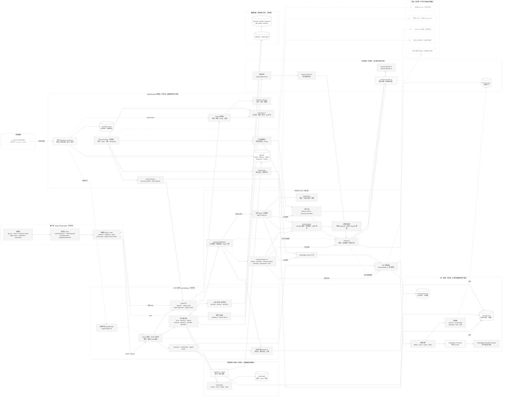

# Bluebird 项目全景架构图

> 扫描基线：`main` @ `0a61e9f`（2026-11-08，PR #72 品牌定位合并提交）。
> 本文件只做结构梳理，不修改业务代码。

## 图例

- **实线矩形**：已实现并在运行链路中生效。
- **虚线矩形**：部分实现或存在明确边界（能力可用，但有未闭环项）。
- **浅色虚线矩形**：未实现 / 规划中，当前不参与运行链路。
- **圆柱节点**：数据存储（单机原子文件）。
- 箭头方向 = 调用或数据流方向；虚线箭头 = 降级/异步/未实现路径。

## 总架构图（Mermaid，横向布局）

## 模块说明

| 层 | 真实模块 | 职责 | 状态 |
| --- | --- | --- | --- |
| 客户端 | `App.tsx`、`components/*`、`hooks/*`、`lib/api/*`、`lib/stream.ts`、`lib/agent-results-stream.ts` | 单入口聊天界面；Modal 页面（记忆中心、Agent Team、任务、监控、模型、主题）；REST + SSE 网络层 | 已实现；**移动真机未验证**（Expo Web/RNTL 为准） |
| HTTP 边界 | `server/index.js`、`single-instance.js`、`api-configs.js` | Bearer 鉴权、CORS 白名单、限流、受控 JSON 错误、单实例锁、路由族 | 已实现 |
| 对话与上下文 | `prepareChatRequest`、`server/context/*`、`agent-runtime.js`、`agent-policy.js`、`model-adapter.js` | 上下文编排（历史/摘要/记忆/知识/裁剪/trace）、工具循环、策略、Provider 调用 | 已实现；视觉评测为 3 次多数制，非保证 |
| 记忆系统 | `memory.js`、`memory-decision.js`、`memory-lifecycle.js`、`memory-semantic.js`、`memory-service.js`、`tool-memory-*.js`、`agents/approvals.js` | 记忆 CRUD、生命周期、候选决策、检索打分、维护审批 | 已实现；**语义层是概念词典，不是神经向量** |
| 统一检索 | `server/retrieval/*`、`tool-knowledge-search.js` | 五源连接器、BM25/精确/向量融合、RRF、重排、查询契约、派生索引 | 已实现；外部 Embedding/Reranker **生产端点未验证** |
| Agent Runtime | `server/agents/*`、`scripts/bluebird-watchdog.js`、`scripts/bluebird-supervisor.js` | Router、Task Contract、租约/状态机、Worker、工具网关、结果投递、Watchdog/Supervisor | 四阶段已实现；checkpoint 不可续跑、多进程未启用、OS 调度未安装 |
| 可观测性 | `server/monitoring/*`、`docs/observability.md`、`backup.js`、`scripts/bluebird-*` | 指标/Trace/健康/告警、备份、恢复演练 | 已实现；**灾备离机验证与 agent store 演练未覆盖** |
| 数据存储 | `server/data/*`、`atomic-write.js`、`corruption.js` | JSON 权威存储、原子写、损坏隔离、上传与贴纸库 | 已实现；单写者、全文件重写 |
| 外部依赖 | DeepSeek / 自定义 OpenAI 兼容 Provider、Embedding/Reranker Provider、OS 调度 | 模型与向量能力、服务托管 | Provider 接口已实现；Embedding 生产未验证；OS 调度由部署方接入 |

## 关键依赖关系

1. **对话主链**：`/chat` 或 `/chat/stream` → `prepareChatRequest` → Context Runtime →（记忆检索 `searchMemories` + 知识检索 `retrieval`）→ 输入裁剪 → Agent 工具循环/Model Adapter → Provider。记忆或知识检索失败只降级，不阻断主对话。
2. **工具链**：Agent 工具循环依赖服务端工具注册表、Agent Policy、模型 `tools` 能力；工具结果只作为本轮消息，不写入会话历史。
3. **委派链**：`delegate_to_bot` / `POST /agent-tasks` → Router → Task Store → Worker Runtime → 工具网关 → Memory Bot（独立凭证）→ Result Delivery → 父会话 `bot-result-<taskId>` → `/agent-results/stream` → 客户端。
4. **记忆一致性**：`memory.json` 是权威源；`retrieval/index.json` 是派生索引，生命周期操作即时刷新，普通写入惰性同步；索引损坏可重建。
5. **持久化边界**：所有 JSON 写入经过 `atomic-write.js`，启动由单实例锁保证单写者；任务/会话/索引都不支持多进程并发写。
6. **监督链**：Watchdog 只读任务 Store 与锁文件；仅在服务锁缺失或 pid 已死时执行离线恢复；通过 `intake-pause.json` 影响 Router 接单。
7. **前端契约**：REST 统一走 `apiFetch`（Bearer + 超时 + AbortSignal），聊天与 Agent 结果分别使用 XHR SSE / 结果流；端点只在 `lib/api/endpoints.ts` 构造。

## 薄弱环节

| 级别 | 环节 | 事实与影响 |
| --- | --- | --- |
| 高 | 单机单写者 | 数据目录是内存缓存 + 全文件重写，`single-instance.js` 阻止多实例；任务队列、Worker、Watchdog 都未支持多进程/分布式。多实例部署会覆盖数据。 |
| 高 | 记忆语义能力 | `memory-semantic.js` 是 17 类概念词典，不是神经向量；记忆引擎的开放域语义召回仍是显式缺口。统一检索可接真实 Embedding/Reranker，但生产端点未验证。 |
| 中 | 记忆检索时间预算 | 同步扫描不可抢占：800ms 预算只在入口/出口检查，超预算标记 `degraded` 并保留部分结果，但不保证请求延迟上限；超时同时计入熔断失败。 |
| 中 | 索引刷新成本 | create/merge/supersede/confirm 都触发 `force` 全量同步（全量收集 + 索引写入）；高频写入下是 O(n) 成本，未做去抖或基准。 |
| 中 | Agent Runtime 运维闭环 | checkpoint 只记录进度、不恢复模型回合；`uncertain` 任务需人工；OS 计划任务/服务托管需部署方安装；真实服务杀进程/重启演练未自动化；Watchdog 阈值无 HTTP 配置。 |
| 中 | 单用户权限模型 | `permissions.js` 固定 `local-owner`，无多用户 ACL；高危工具只有拒绝门（无审批流），当前也未注册高危工具。 |
| 中 | 密钥与灾备 | 自定义 Provider API Key 明文存于 `api-keys.json`（文件权限保护）；备份默认排除密钥；离机灾难恢复未被本地路径证明；恢复演练未覆盖 agent task store。 |
| 低 | 验证覆盖边界 | 移动真机未验证；CI 使用 HTTP stub，真实本地 Qwen 仅手动验证；视觉回答为 3 次多数制；另有一次未定位的 agent-run 偶发失败（`REPAIR_ROADMAP.md` §6.7）。 |
| 低 | 检索能力边界 | PDF/DOCX 解析与查询改写未实现；document/web/code 为全局可见（单用户部署）；两条记忆检索路径（memory 引擎与统一检索 memory 连接器）存在规则维护成本。 |

## 阅读说明

- 图中“已实现”指代码与测试在该仓库内真实存在并通过门禁，不代表已在生产环境部署。
- “部分实现/未实现”按仓库文档与代码事实标注，不把规划项画进运行链路。
- 关键证据位置：`AGENTS.md`、`docs/agent-runtime-stage1..4.md`、`docs/memory-link-audit.md`、`docs/unified-retrieval.md`、`docs/observability.md`、`REPAIR_ROADMAP.md`。
